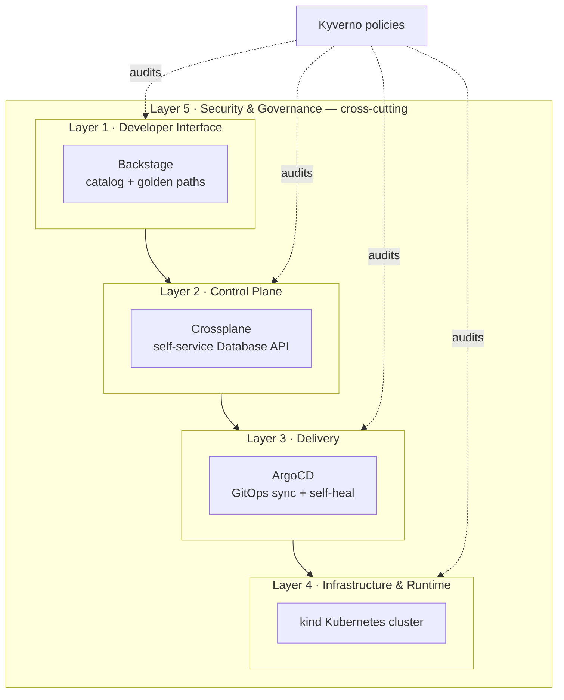

# Reference Internal Developer Platform (IDP)

A small, **forkable, security-first** reference platform you can stand up on your
laptop with one command. It accompanies the PlatformOps Studio video:

> 🎬 **What is an Internal Developer Platform? (And why 2026 needs one)** — ▶️ `[VIDEO_LINK]`

Everything runs locally in [kind](https://kind.sigs.k8s.io/). There are **no cloud
accounts, no billable resources, and no real secrets** — so it is safe to run,
safe to film, and safe to hand to a beginner.

---

## The 5 layers



A developer asks for something in **Layer 1**, the **Layer 2** control plane turns
that request into real resources, **Layer 3** delivers it from Git, it runs on
**Layer 4**, and **Layer 5** governs all of it.

---

## What you'll build

- A **kind** cluster (Layer 4) — the runtime everything sits on.
- **ArgoCD** (Layer 3) managing an app-of-apps from this repo, with **self-heal** on.
- **Crossplane** (Layer 2) publishing a self-service `Database` API. Creating a
  `Database` claim provisions a connection `ConfigMap` — swap in a cloud provider
  later and the developer-facing API never changes.
- A hardened **demo-app** (unprivileged NGINX) deployed entirely via GitOps.
- **Kyverno** (Layer 5) policies in **Audit** mode: disallow-privileged,
  require-runAsNonRoot, and keyless image-signature verification.
- **Backstage** catalog + a "new microservice" golden-path template (Layer 1
  entities). A ready-to-run portal is built in Episode 02.

---

## Prerequisites

Install these (versions in `.tool-versions` are what the video used):

| Tool | Purpose |
|------|---------|
| Docker (≥ 26) | runs the kind cluster |
| [kind](https://kind.sigs.k8s.io/) v0.24 | local Kubernetes |
| kubectl v1.31 | talks to the cluster |
| Helm v3.16 | installs Crossplane |
| [Task](https://taskfile.dev) v3.39 | one-command workflows |

> Using [asdf](https://asdf-vm.com) or [mise](https://mise.jdx.dev)? Run
> `asdf install` / `mise install` to get the pinned versions from `.tool-versions`.

---

## Quickstart (one command)

```bash
git clone https://github.com/PlatformOpsStudio/idp-reference.git
cd idp-reference
task up
```

`task up` creates the cluster, installs all four layers, and runs a preflight
check. When it finishes, open the ArgoCD UI:

```bash
task forward      # prints the admin password, forwards https://localhost:8080
```

> The password is printed to **your** terminal only. Log in before recording,
> then hide the terminal. It is never committed to Git.

---

## Step-by-step (mirrors the video)

### Layer 1 — Developer Interface (Backstage)
The things a developer sees are declared as Backstage entities:

```bash
cat backstage/catalog-info.yaml
cat backstage/templates/new-microservice/template.yaml
```

`catalog-info.yaml` is the **software catalog** (services + owners);
`template.yaml` is a **golden path** — the "Create a new service" button.

### Layer 2 — Control Plane (Crossplane)
Show the self-service API and the resource a developer's claim produced:

```bash
kubectl get compositions
kubectl get xrd
kubectl get database -n demo
kubectl get configmap -n demo demo-db-connection -o yaml
```

`orders-db` is the developer's claim; `demo-db-connection` is what the platform
provisioned on their behalf — no cloud console involved.

### Layer 3 — Delivery (ArgoCD)
In the ArgoCD UI, open the **`demo-app`** application and show `Synced / Healthy`
and the resource tree. Git is the source of truth; ArgoCD keeps the cluster
matching it.

### Layer 4 — Infrastructure & Runtime
The invisible foundation:

```bash
kubectl get nodes -o wide
```

### Layer 5 — Security & Governance (cross-cutting)
Guardrails that span every layer (Audit mode this episode):

```bash
kubectl get clusterpolicy
```

### 💥 The money moment — GitOps self-heal
Delete part of the platform and watch it come back on its own. Keep the ArgoCD
`demo-app` tile on screen:

```bash
task demo
```

You'll see the tile flip **Synced → OutOfSync → Synced** while ArgoCD recreates
the Deployment. Nobody ran a fix. That's the difference between a pile of scripts
and a platform.

### Reset between takes

```bash
task reset
```

---

## Security notes

This repo is meant to be an example of **secure by default**:

- **No secrets in Git.** The only credential is ArgoCD's auto-generated admin
  password, read at runtime by `task forward` and never written to disk.
  `.gitignore` excludes kubeconfigs and `.env` files.
- **Least-privilege RBAC.** The Crossplane provider runs as a pinned
  ServiceAccount bound to a ClusterRole scoped to **ConfigMaps only** — never
  `cluster-admin`. See `crossplane/provider-kubernetes.yaml`.
- **Hardened workloads.** `demo-app` runs non-root, read-only root filesystem,
  no privilege escalation, all capabilities dropped, seccomp `RuntimeDefault`,
  and with its ServiceAccount token unmounted. The `demo` namespace enforces the
  Kubernetes **restricted** Pod Security Standard.
- **Pinned everything.** Cluster image, charts, install manifests, and app image
  are version-pinned so the demo is identical every time. Pin images by digest
  for production.
- **Policy + supply chain.** Kyverno ships three policies, including keyless
  image-signature verification. They run in **Audit** here (report, don't block)
  so the overview stays focused; the enforce-mode walkthrough with `cosign` is
  its own episode.
- **On camera:** don't show `task forward` output, secret values, `kubectl config`,
  or your shell history. Use a dedicated kubeconfig: `export KUBECONFIG=$PWD/.kube/idp-demo.config`.

---

## Cleanup

```bash
task destroy      # deletes the kind cluster and everything in it
```

Because everything lives in the disposable kind cluster, teardown is complete and
leaves nothing running or billable.

---

## Repository layout

```
.
├── Taskfile.yml            # setup | deploy | demo | reset | destroy | verify | forward
├── kind/                   # Layer 4 — cluster definition
├── argocd/                 # Layer 3 — app-of-apps + demo-app Application
├── apps/demo-app/          # hardened workload delivered via GitOps
├── crossplane/             # Layer 2 — provider, XRD, Composition, claim
├── kyverno/                # Layer 5 — policies (Audit mode)
├── backstage/              # Layer 1 — catalog entities + golden-path template
├── scripts/                # verify / demo / reset / forward
└── .github/workflows/      # CI: yamllint, shellcheck, kubeconform
```

---

## License

MIT — see [LICENSE](./LICENSE). Contributions welcome; see
[CONTRIBUTING.md](./CONTRIBUTING.md).
